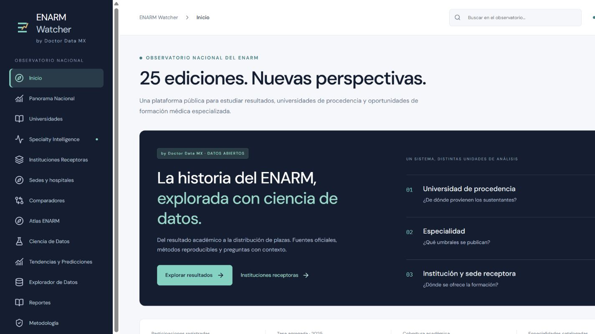
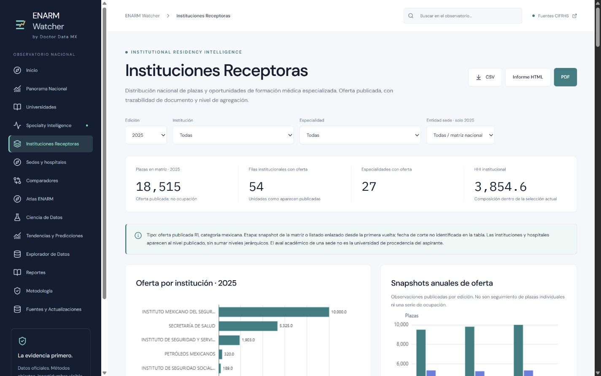

# ENARM Watcher

**Observatorio Nacional del ENARM · by Doctor Data MX**

Plataforma pública estática de resultados académicos, universidades de procedencia, especialidades e instituciones receptoras. Fuentes CIFRHS verificables, originales preservados y métodos reproducibles. Iniciativa independiente, sin afiliación oficial.

## Cobertura

| Conjunto | Ediciones | Registros |
|---|---|---:|
| Resultados académicos, categoría mexicana | 2001–2025 | 2,528 filas |
| Umbrales por especialidad | 2022–2025 | 107 filas; 28 especialidades |
| Matrices de oferta R1 | 2023–2025 | 4,267 celdas, incluidos ceros publicados |
| Oferta por sede | 2025 | 2,544 códigos; 18,515 plazas |

La matriz y el detalle de sedes de 2025 concilian en total, por especialidad y por las cuatro instituciones principales. Son niveles alternativos, nunca sumables. Las 471 claves de procedencia conservan denominación/entidad e incluyen cambios históricos y categorías residuales; no equivalen a 471 universidades distintas.

## Módulos

Inicio, Panorama Nacional, Universidades y comparador académico de hasta cinco, Specialty Intelligence, Instituciones Receptoras y comparador de hasta cinco, Sedes, Atlas, Ciencia de Datos, Tendencias y Predicciones, Explorador, Reportes, Metodología y Fuentes. Búsqueda global y filtros en rutas compartibles.

Análisis por edición: Pearson/Spearman, Pareto, Wilson, beta-binomial, descomposición geográfica, HHI/Gini/Lorenz. Oferta: diversidad, especialización relativa, correspondencias y clustering de composición con sensibilidad. El motor longitudinal de especialidades exige elegibilidad antes de publicar resultados.

Exportaciones: PDF directo, HTML autónomo, CSV, JSON, PNG en gráficas y SVG del atlas. La oferta no se interpreta como asignación, ocupación o calidad. No se infiere origen–destino individual. No se mezclan medias, medianas ni escalas históricas sin revisión. Los pronósticos sin comparabilidad o validación suficiente permanecen desactivados.

## Ejecutar

```powershell
npm ci
npm run dev
```

Abrir `http://127.0.0.1:5173/enarmwatcher/`.

## Reconstruir y verificar

Python 3.12+ y Node 22+.

```powershell
python -m pip install -r requirements.txt
npm ci
npm run data
npm test
npm run build
```

`npm run data` extrae DOC con word-extractor, DOCX con XML y PDF con pdfplumber; valida, concilia y genera análisis y API JSON por módulo, DuckDB y Parquet Zstandard. Reconstruye desde originales sin red. El sitio no necesita backend ni Python durante la consulta.

Arquitectura: `pipeline/` → `data/normalized/` + `data/warehouse/` → `public/data/` → React/TypeScript/Vite/ECharts → `dist/`. La carga se separa por módulo.

## Actualizar fuentes

`python -m pipeline.discover` descarga fuentes sin sobrescribir capturas aprobadas. `python -m pipeline.check_updates` compara hashes y descubre enlaces, con reporte de diferencias y candidatos separados. El monitor semanal está en `.github/workflows/update-data.yml`.

Una nueva edición requiere revisar fuente, formato, corte, población y etapa; adaptar parser y controles, añadir pruebas y reconstruir. Los candidatos de formato o metodología desconocidos no se promueven silenciosamente. No se procesan folios de aspirantes.

## Publicación

Objetivo: `https://github.com/doctordatamx/enarmwatcher`.
URL prevista: `https://doctordatamx.github.io/enarmwatcher/`.

**No está verificada la publicación.** GitHub devuelve `Repository not found`: puede ser privado o inexistente. Se necesita acceso autenticado al objetivo y habilitar Pages con GitHub Actions. No se cambió visibilidad ni se publicó en otro hosting.

`.github/workflows/deploy.yml` reconstruye, prueba y publica `dist/` después de superar controles. `quality-check.yml` verifica pull requests. Son workflows preparados, sin afirmar ejecución remota.

## Documentación

- [Cumplimiento y pendientes](docs/master_prompt_status.md).
- [Fuentes receptoras](docs/receiving_institutions_sources.md), [cobertura](docs/receiving_institutions_coverage.md), [diccionario](docs/receiving_institutions_data_dictionary.md) y [métodos](docs/receiving_institutions_methodology.md).
- [Métodos académicos](docs/academic_methodology.md), [especialidades](docs/specialty_methodology.md) y [verificación](docs/verification.md).
- Inventarios y matrices CSV en `docs/`; validación en `data/platform_validation.json`.
- [Contribuir](CONTRIBUTING.md), [historial](CHANGELOG.md), [licencia](LICENSE).

MIT se aplica al código original; las fuentes y cartografía conservan sus derechos y atribución. El script R citado en el prompt no estaba entre los adjuntos disponibles: no se declara equivalencia numérica con ese código.

## Capturas reales





## Tendencias actualizadas

`#/predictions` y `#/lab` comparten el explorador de series y elegibilidad. La cobertura se genera desde los datos actuales: académicos 2001–2025, especialidades 2022–2025 y oferta institucional 2023–2025. Los filtros se guardan en la URL. `pipeline/trends.py` se ejecuta automáticamente con la partición de datos. El laboratorio de especialidades y simulador permanece en `#/specialty-lab`.


La vinculación documental de Panamericana reúne 24 ediciones (2002–2025) en un perfil. Las 471 claves originales se conservan en las filas y se representan actualmente en 468 perfiles. Véase [revisión histórica](docs/panamericana-history-review.md) y el registro explícito `data/university_identity_links.json`. La vinculación no acredita comparabilidad de tasas ni equiparación de puntajes.
